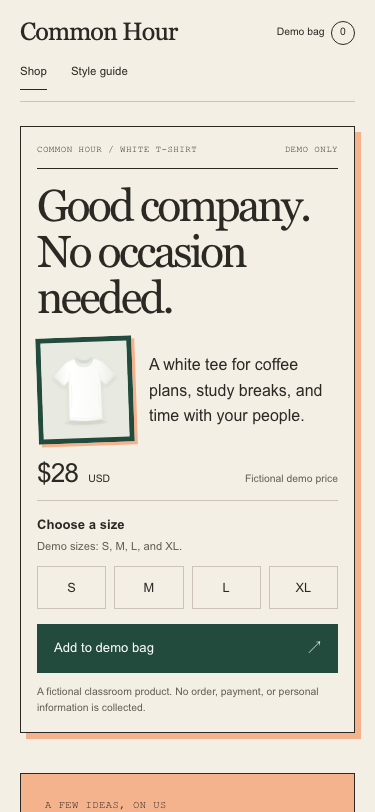

# Full assignment walkthrough — October 25, 2026

This trial began with a new GitHub template copy, then a fresh SSH clone. The original template tree was fb4d7be5ae0415460b60646ca22aba375b69729d; GitHub generated the trial's own initial commit 2ac7fd2. The remote was verified as this trial, not the instructor template. Existing class SSH and Node setup were used (Node v24.20.0, npm 11.19.0).

**Evidence limits:** all learner utterances below are simulated by a separate agent. No actual student, customer research, or human browser review participated. File edits, GitHub issues/commits/PR, terminal checks, Chromium screenshots, Computer Use interactions and deployment verification are actual operations. ChatGPT desktop's project-picker UI was not exercised; the local agent conversations were simulated as requested.

## What was made

Two concise persona hypotheses and a brief in SPEC.md; two original, same-content, source-based hero studies; a name-only SVG wordmark with small and single-color presentations; a live style guide sharing the storefront's assets, tokens and actual text/button classes; a branded responsive product page; and two explained persuasion applications. The product stays plain, white and unprinted. The $28 price is explicitly fictional.

The feature remains narrow: S/M/L/XL and a temporary demo bag, with no checkout, persistence, accounts or payments.

## Real sources inspected

- Josef Müller-Brockmann, _Musica Viva_, 1957, MoMA 58.1960: https://www.moma.org/collection/works/4885. Computer Use opened the artwork lightbox. Compact top columns, an open center and repeated diagonal rules informed study A.
- Ettore Sottsass, _Carlton_ room divider, 1981, The Met 1997.460.1a–d: https://www.metmuseum.org/art/collection/search/486989. Computer Use viewed the object on its public page. Layered angular members and contrasting surfaces informed study B.
- Cialdini's official overview: https://www.influenceatwork.com/7-principles-of-persuasion/. The selected applications propose useful value first and an approachable shared-interest voice. They are not measured conversion results.

No museum artwork is copied into the website. The shirt SVG came from the teaching template; the compositions and wordmark are original implementation work.

## Critical findings and corrections

| Finding                                              | Evidence and correction                                                                                                                                                                                                                       |
| ---------------------------------------------------- | --------------------------------------------------------------------------------------------------------------------------------------------------------------------------------------------------------------------------------------------- |
| First-feature name understated the job               | “Hero and visible identity” hid the brief, comparisons, logo and live guide. Instructor instructions now name the full first branded storefront/live-guide scope.                                                                             |
| Branch setup came too late                           | The original coach saved SPEC/previews before introducing the feature branch. The revised path creates issue #1 and its branch after scope agreement, before student files.                                                                   |
| A text-only A/B index made comparison awkward        | Added matching actual screenshot thumbnails with full live links, so the learner need not hold A in memory while opening B.                                                                                                                   |
| Valid code did not guarantee intended typography     | A missing class prevented the intended preview font treatment. AI rendered QA caught it; both current screenshots were recaptured and the choice reconfirmed.                                                                                 |
| A technically valid logo carried an unwanted meaning | The simulated learner associated the first circles with wedding rings. The chosen asset uses the name alone. This is a role-play preference, not real audience evidence.                                                                      |
| Passing phone behavior was insufficient              | The first phone page put the product after the purchase panel. A compact shirt preview now appears before size selection without adding a giant poster. A real-browser regression checks image visibility/order and successful selection/add. |
| Shared CSS alone could leave the guide stale         | Updated manual direction/voice/type content and verified rendered logo, type metrics and action colors across shop and guide.                                                                                                                 |
| Copied completion wording became stale               | Comparison copy was made historical, public approval references were labeled simulated, and README/current-stage guidance now supports resuming instead of restarting.                                                                        |

The revised instructor coach also bounds the secondary persona and simple wordmark, explains an image-access fallback, rejects required size validation as a persuasion application by itself, and makes the learner's keep/merge decision explicit without an outside reviewer.

## Actual verification

- Fresh-copy baseline: `npm ci`, `npm run setup:browser`, `npm run check` succeeded: formatting/lint, 4 server and 9 browser cases.
- Final branded implementation: `npm run check` succeeded: formatting/lint, 4 server and 12 Chromium cases.
- Added checks exercise equal content and working actions in both studies, rendered shop/guide identity agreement, and a 375px shopping flow with the visible product before size selection.
- Computer Use operated Skip → S → Right to M → Tab → Enter; the actual browser added one size M item and displayed visible focus.
- AI reviewed the 1280px shop and guide and actual 375px test screenshots. The mobile image-order issue was then revised and retested.
- A review screenshot initially captured the top of the guide instead of the intended typography section: visibility was insufficient to ensure viewport position. The test now scrolls the actual specimen into view and checks it is in the viewport before capturing.
- Final CI, merge and Pages results are recorded in [PR #2](https://github.com/kaw393939/is117-brand-studio-trial-1025/pull/2), avoiding a self-updating commit-hash ledger.

## Screenshots

[Desktop storefront](evidence/desktop-shop.png) · [Keyboard focus](evidence/keyboard.png) · [Final phone layout](evidence/mobile-shop.png) · [Guide specimen on phone](evidence/mobile-guide.png) · [Rejected circles proposal](evidence/rejected-rings-logo.png)

## Recorded instructional sequence

These are the simulated exchanges used to evaluate the coaching path, with real operations separately labeled. They do not establish student learning or customer response.

**1. setup — simulated learner**

Read AGENTS.md and SPEC.md. Help me get this running, then guide me through the brand studio one decision at a time.

**2. setup — coach**

We will get the neutral shop running first, then make your brand decisions together. I will check this cloned folder and its setup.

**3. setup — actual evidence**

Created own template copy is117-brand-studio-trial-1025, SSH-cloned it, verified own origin, Node v24.20.0 / npm 11.19.0; npm ci, setup:browser and check passed (4 server, 9 browser cases).

**4. baseline — coach**

Try a size and Add to demo bag. What changed?

**5. baseline — simulated learner**

The message says a size M shirt was added, and the demo bag now has 1 item.

**6. scope — coach**

Our first feature is your first branded storefront and live style guide: a small audience brief, two hero previews to compare, then a logo and one coherent page. The size and bag behavior stay; checkout stays out. Shall we use that scope?

**7. scope — simulated learner**

Yeah, that works. I'd like to see the two options before picking the look.

**8. audience — simulated learner**

I spend a lot of time at coffee shops studying with friends, so I'd like the shirt to fit that kind of everyday hangout.

**9. audience — coach**

I drafted a primary audience hypothesis from your coffee-shop idea: a student moving between study and time with friends, who wants a relaxed everyday identity. My added assumption is that a loud fashion logo might feel too try-hard. Does that fit, or would you change it?

**10. audience — simulated learner**

That fits. I wouldn't wear a huge logo, but I still want it to feel like a brand instead of just a blank shirt.

**11. brief — coach**

For that everyday hangout, I'd propose Common Hour: 'An everyday tee for making room for each other.' Its brand character could be Everyperson—approachable and welcoming—with a warm, plainspoken, unhurried voice. That is a proposal, not an audience fact. Would you keep this direction or change it?

**12. brief — simulated learner**

I like Common Hour. 'Making room for each other' sounds a little like a campus campaign, though. Could the line feel more casual?

**13. brief — coach**

Agreed—the name can stay, and the language can loosen up. How about 'Good company. No occasion needed.' with 'A white tee for coffee plans, study breaks, and time with your people' underneath?

**14. brief — simulated learner**

Yeah, I like that. 'No occasion needed' feels more like something I'd actually say.

**15. brief — coach**

Our brief is Common Hour, the casual line you chose, and an Everyperson character: welcoming rather than exclusive, with a warm, plainspoken, unhurried voice. A small secondary hypothesis is someone visiting a café alone before friends arrive, so the page should welcome them too. Would you keep that brief?

**16. brief — simulated learner**

Yes, keep it. I like that it still feels welcoming if you show up on your own.

**17. prediction — coach**

I'll show a structured menu-like version and a more layered noticeboard-like version, using your exact same words and shirt. Before we compare them, what do you predict should stand out first for your café visitor?

**18. prediction — simulated learner**

I think the shirt should stand out first, then 'Good company' so they get the vibe pretty quickly.

**19. comparison — actual evidence**

Computer Use inspected both reference artworks and both built hero studies. Initial missing typography class was found during rendered QA and fixed. Matching 1280x720 screenshots were recaptured before reconfirming the learner's choice. Preview controls work with shared shop.js.

**20. comparison — coach**

Here are the two actual hero studies. A uses grid and repeated rhythm; B uses layered, angular panels. Both keep your exact words, white shirt, price, sizes and action. Which direction would you keep or adjust, and why?

**21. comparison — simulated learner**

I like B—the tilted green frame and peach bits feel more like a café. But the sizes are cut off and I can't see the bag button, so I'd bring those higher.

**22. comparison — coach**

A typography class was missing in that first capture; I corrected it and recaptured both studies at the same size. B now uses the intended serif headline; the controls are still too low. Do you still want B, with the size choices and action moved higher?

**23. comparison — simulated learner**

Yes, still B. The headline feels more like a café now, and I like the layered frame. Definitely move the sizes and button higher.

**24. persuasion — coach**

For persuasion, I suggest two modest choices: useful outfit ideas available freely before buying (reciprocity), and friendly café/study-break language that reflects your visitor's interests (liking). No fake reviews or stock pressure, and we won't claim these increase sales. Would those serve your visitor, or would you change them?

**25. persuasion — simulated learner**

Those fit. I'd keep the outfit ideas short and easy to read, without making people sign up to see them.

**26. logo — coach**

Here is one simple logo proposal, using a shared-center mark and the Common Hour name. It shows header size, small size, and a true single-color version. Would you keep or adjust it?

**27. logo — simulated learner**

I like the name lettering, but the linked circles make me think of wedding rings. Could we change that little symbol?

**28. logo — coach**

That association works against the casual idea. We can remove the symbol and let the name carry the logo; a wordmark is enough here. Would you prefer that simpler version?

**29. logo — simulated learner**

Yes, I'd prefer just the name. The lettering already gives it enough personality.

**30. check — actual evidence**

Branded trial passed npm run check: formatting, lint, four server cases and 12 Chromium cases. Added meaningful checks for equal-offer working studies, rendered shop/guide identity agreement, and a narrow-screen shopping journey.

**31. check — coach**

The checks actually ran: 4 server cases and 12 browser cases passed. One browser check clicks Add without a size, expects the size error, and expects count 0. It is E2E because it drives Chromium, and negative because it tries unsuitable input. What bug would it catch?

**32. check — simulated learner**

It would catch the site adding a shirt without a size—even if it showed the error but still increased the bag count.

**33. browser — coach**

Yes—that catches an error message masking a wrong state change. Now inspect the actual desktop shop and guide. What visible detail makes the brand feel right for your visitor, or still feels wrong?

**34. browser — simulated learner**

The cream and dark green feel like a café menu, and the lettering matches in the guide. I like it—and I can see all the sizes and the bag button now.

**35. keyboard — actual evidence**

Computer Use operated Tab → Enter on Skip → Tab to S → Right to M → Tab → Enter. Actual browser selected M, count became 1, and the Add button held focus. Screenshot keyboard.png saved.

**36. keyboard — coach**

The actual keyboard run selected M and the bag count became 1. Inspect the screenshot. What tells you where the keyboard focus is?

**37. keyboard — simulated learner**

The extra outline around 'Add to demo bag' shows the focus. M is filled green to show the selected size.

**38. mobile — coach**

Inspect the actual 375px first-view and controls screenshots. What still feels confusing or awkward on the phone-sized page?

**39. mobile — simulated learner**

The buttons are clear, but the shirt is below the whole purchase box. I'd want to see it before choosing a size on the phone layout.

**40. mobile — coach**

Good catch. I will show a compact shirt preview before the size choice without pushing the action under a full-height poster.

**41. mobile — actual evidence**

The mobile layout was revised to show the unchanged shirt SVG beside supporting copy before price/size controls, with only one image exposed per breakpoint. A real-browser regression now checks a visible shirt before the size fieldset.

**42. mobile — coach**

I moved a compact shirt view before price and size choice and kept the large frame on desktop. The mobile test checks the shirt precedes the size controls and can add M. Does the revised screenshot address the problem?

**43. mobile — simulated learner**

Yes, that fixes it. The shirt is visible before the size choices, and the buttons still fit clearly on the screen.

**44. concrete PR — actual evidence**

PR #2's check job passed on implementation commit a9093e7 in [run 40259588414](https://github.com/kaw393939/is117-brand-studio-trial-1025/actions/runs/40259588414). The coach presented the actual changed files, checks, and requested revisions before the keep decision.

**45. concrete PR — coach**

The concrete PR contains the reviewed shop, guide, wordmark, two studies, decisions, and tests. The phone revision is included, and the checks passed. Would you keep and merge this version, or request another change?

**46. concrete PR — simulated learner**

Yes, keep and merge it. The phone layout fixes the issue I noticed, and the overall look feels right for Common Hour.

## Delivery

One feature issue, a feature branch, explainable design/implementation commits and a reviewed PR carry the work. The simulated learner's final keep/publish reply and actual GitHub delivery are recorded in PR #2. The instructor's unfinished template contains only instruction fixes and research links, not this solution.
